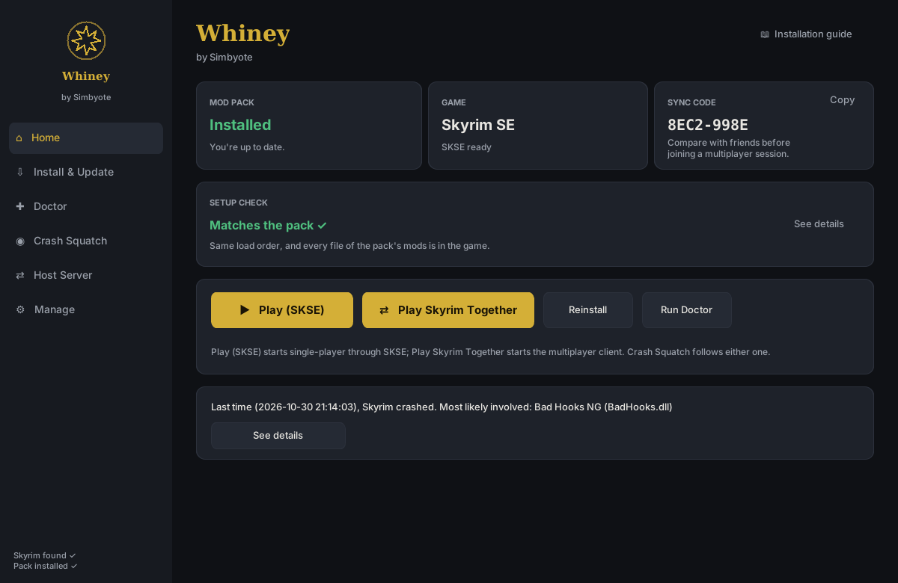
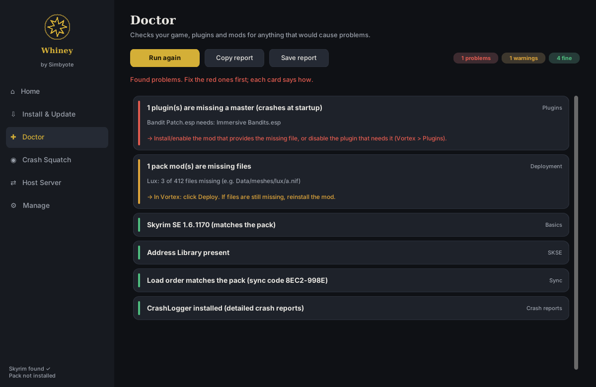
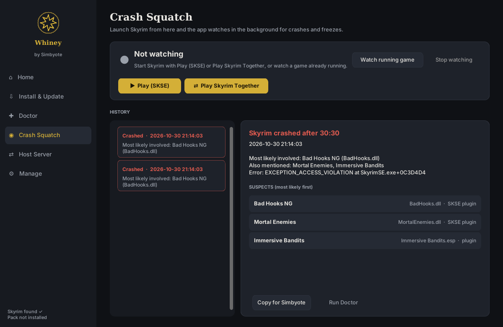

# Whiney

Keep a group's Skyrim Special Edition installs identical. One person (the
maintainer) packs their Vortex mods and builds `Whiney.exe`; everyone else
runs it, and it installs the pack through Vortex, applies the pack's load
order and settings, checks the setup, explains crashes, and helps host
Skyrim Together.



## Features

| Section | What it does |
| --- | --- |
| **Home** | Install state, game version, the load order's **sync code** (matching codes mean matching load orders), a **setup check** run at every start, and the Play buttons |
| **Install & Update** | Downloads the pack, checks its SHA-256, unpacks it safely, hands Vortex one zip per mod, applies the load order and INIs, and checks every deployed file. Resumable, and cancellable at any point |
| **Doctor** | Finds what crashes Skyrim or desyncs multiplayer: missing masters, bad order, the 254-plugin limit, wrong game or SKSE version, missing Address Library, undeployed mods. Each finding says how to fix it |
| **Crash Squatch** | Launches the game (SKSE or Skyrim Together) and watches it. On a crash or freeze it reads the crash logs and names the most likely mods |
| **Host Server** | Starts the Skyrim Together server, shows the address to share, opens the firewall, and explains port forwarding and CGNAT |
| **Manage** | Save backups (restore by merging or replacing), the player's original settings, freeing disk space, uninstalling |

<p>
  
  
</p>

## Before you use it: mod permissions

Whiney shares a mod pack by uploading archives of your installed mods to a
cloud drive and having your group download them. **Many mod authors don't
allow their files to be re-uploaded.** Use Whiney only for private groups,
and only with mods whose permissions allow it (on Nexus Mods: the mod page's
"Permissions and credits"). You are responsible for what you distribute.

## Who uses what

| You are | You use | Guide |
| --- | --- | --- |
| A player | `Whiney.exe`, from your maintainer | [`release/README.txt`](release/README.txt) (also opens from Home) |
| A maintainer | the `.bat` files in this folder, on Windows | [`docs/guides/build.md`](docs/guides/build.md) |
| A contributor | `make`, in WSL or Linux | [`CONTRIBUTING.md`](CONTRIBUTING.md) |

**Running your own pack:** clone this repository on the Windows PC that has
your Vortex mods, run `pack_mods.bat`, upload the archive, put its file ID in
`pack_config.json`, and run `build.bat`. [`docs/guides/build.md`](docs/guides/build.md)
walks through it.

## Layout

```
src/whiney/             the app (package `whiney`)
tests/                  pytest: software and live suites, builders, fixtures
docs/                   architecture, concepts, requirements, guides, the documentation standard
assets/                 the icon, bundled into the exe
release/README.txt      the players' guide, bundled into the exe
*.bat                   the maintainer's commands: build, pack, update, baseline, run from source
Makefile                development commands (WSL / Linux)
pyproject.toml          package metadata, pytest, ruff and mypy settings
requirements*.txt       pinned dependencies: runtime, build (+PyInstaller), dev (+pytest, ruff, mypy)
```

## Development quick start (WSL / Linux)

```
make venv       once
make check      lint, type check and software tests, before every commit
make            every other command
```

Documentation starts at [`docs/README.md`](docs/README.md); each section of
the exe is described in [`docs/guides/ui.md`](docs/guides/ui.md).

## What is *not* in this repo

- Mod archives (`*.tar.gz`): they live on the maintainer's cloud drive.
- `pack_config.json`, `pack_manifest.json`, `last_update.json` and `_packinfo/`:
  the maintainer's local state. The exe is built on the maintainer's PC
  because it bakes in that PC's load order, INIs, game version and deployed
  files.

## Contributing and license

Contributions are welcome: see [`CONTRIBUTING.md`](CONTRIBUTING.md) and the
[code of conduct](CODE_OF_CONDUCT.md). Security issues: [`SECURITY.md`](SECURITY.md).

Whiney is released under the [MIT License](LICENSE). It is a fan-made tool,
not affiliated with Bethesda, Nexus Mods, Vortex or the Skyrim Together
project.
